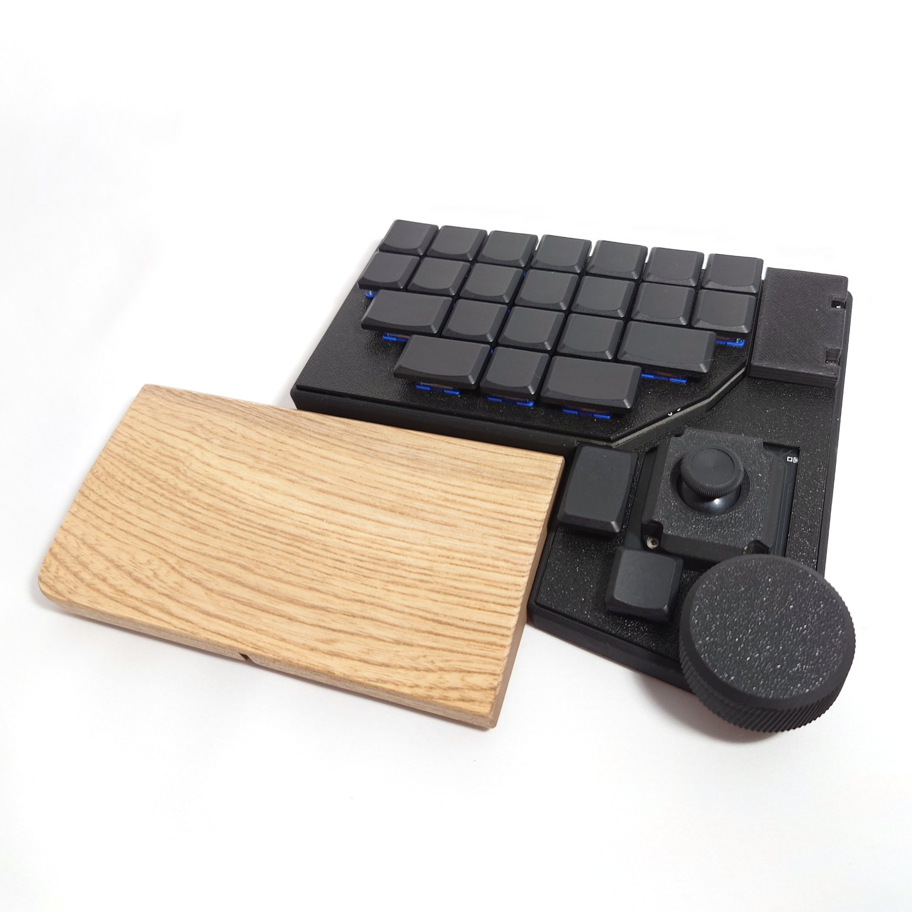

 
# GBC24 ビルドガイド

> **⚠ 注意事項**   
> 本製品は本体を「組み立て済み」の状態でお届けします  
> キースイッチやキーキャップなどは別途ご購入のうえ、ご自身で取り付けてください  
> 原則としてどの頒布場所でも仕様は同じですが、価格は頒布場所によって異なります  
 
> **⚠ 不具合がある場合は、すぐにご連絡ください**  
> 接触不良が改善しない、反応が悪い、認識が頻繁に切れるなど、使用に関わる不具合がある場合は、すぐに作者へご連絡ください。  
> 連絡の方法は、「[お問い合わせについて](#お問い合わせについて)」をご覧ください。

### ご購入前にお読みください
 
本製品をご購入いただいた時点で、下記「譲渡・再販について」の内容に同意いただいたものとみなします。  
あわせて、「動作環境について」もご購入の前にご確認ください。
 
### 譲渡・再販について
 
本製品は、実際にお使いになる方へ定価でお届けすることを目的に、電脳甲板工廠（九嶋 八）が頒布しています。  
この目的を守るため、また、正規の販売場所以外で入手された製品については同梱品の不足や不具合への対応ができないため、以下のとおり定めます。
 
1. 正規の販売場所はBOOTH「電脳甲板工廠」、遊舎工房、および当方が告知したイベントです。
2. 本製品（完成品・未完成品・付属部品を問わず）を、ネットオークション、フリマサービス、その他の方法により、第三者へ有償で譲渡することを禁止します。
3. 正規の販売場所以外で入手された製品は、サポートの対象外とします。
4. 本項に反する行為を確認した場合、ご注文を取り消し、以後の販売をお断りすることがあります。
  
制定：2026年11月13日

### 到着後の確認について
 
製品がお手元に届いてから2週間以内に、次の2点をご確認ください。
 
- 同梱物がそろっているか（「[付属しているもの](#付属しているもの)」をご覧ください）
- 正常に動作するか
 
不足や不具合があった場合は、「[お問い合わせについて](#お問い合わせについて)」の方法でご連絡ください。  
2週間を過ぎてからのご連絡は、応相談とさせていただきます。
 
### 動作環境について
 
- 対応OS：Windows／macOS／iPadOS（iPadはUSB Type-C端子を搭載した機種）
- 接続：USB Type-C（有線）。専用ドライバーのインストールは不要です。
- 動作確認済みのソフト：WindowsではAdobe PhotoshopとCLIP STUDIO PAINT、iPadではProcreateとCLIP STUDIO PAINT  
  macOSでも動作する見込みですが、確認はしていません。
 
次の点にご注意ください。
 
- キーの割り当ての変更とファームウェアの更新には、ChromeまたはEdgeが使えるPC（Windows／macOS）が必要です。  
  iPadやスマートフォンだけでは変更できません。
- ジョイスティックをゲームパッドとして使えるのは、Windowsのみです（DirectInput方式。XInputには対応していません）。
 
## はじめに
 

 
このたびはご購入いただきありがとうございます。  
本製品は、本体をはんだ付けなどを施して組み立てた状態でお届けする「組み立て済み」の製品です。 
別途購入が必要なものが存在し、キースイッチとキーキャップの取り付けなど、一部の作業はご自身で行っていただきます。
 
GBC24は絵を描く方向けに開発した左手デバイスです。
 
写真は作成見本であり、商品内容と同一ではありません。  
また、仕様は予告なく変更されることがあります。
 
本体の形は3Dビューアで回したり拡大したりして確認できます。  
[GBC24 3Dビューア](https://kushima8.github.io/gbc24_3d_viewer.html)  
3Dビューアの形状は参考であり、寸法や細部は実物と異なる場合があります。
 
### お問い合わせについて
 
組み立てや使用にあたり不明点や疑問点などがありましたら、次のいずれかの方法でご連絡ください。
 
- 作者の[Xアカウント](https://x.com/kushima8)へのリプライ、またはDM
- メール：`kushima89（アットマーク）gmail（ドット）com`
 
メールアドレスは迷惑メール対策のため、一部を置き換えて記載しています。  
「（アットマーク）」を「@」に、「（ドット）」を「.」に置き換えて、半角で入力してください。  
 
上記以外の方法でご連絡をいただいても、対応いたしかねます。  
また、発送を伴う対応は、原則として日本国内に限らせていただきます。  

XはFF外からのリプライは通知をオフにしており、気づかない場合がございます。  
あらかじめご了承ください。  
また、Discordなどのコミュニティで、作者以外の方に質問して解決を図ることは推奨しておりません。
 
### 開発協力
 
本製品の開発にあたり、[すこやかむいむい](https://x.com/sukoyakamuimui)さんにご協力いただきました。  
ありがとうございます。
 
むいむいさんご本人から、紹介イラストもご提供いただきました。
 

 
### ファームウェアについて
 
ファームウェアに[qmk_firmware](https://github.com/qmk/qmk_firmware)を採用しています。  
QMKにGBC24のコードはマージされていませんので、この[ブランチ](https://github.com/kushima8/qmk_firmware/tree/reex)を使用してください。  
動作確認のためのコンパイル済みファームウェアとして、[HEXファイル](https://github.com/kushima8/GBC24/tree/main/HEX)と[UF2ファイル](https://github.com/kushima8/GBC24/tree/main/UF2)を用意しています。
 
付属のPro Micro（Type-C版）には、あらかじめファームウェアを書き込んであります。  
お手元に届いたら、組み立ての前にファームウェアを最新版に更新することを強く推奨します（「[2. ファームウェアを最新版に更新](#2-ファームウェアを最新版に更新)」参照）。  
ビルドガイドと各マニュアルは、最新版のファームウェアをもとに作成しています。  
ファームウェアの書き込み・更新の手順は下記をご覧ください。  
[ファームウェア書き込み（更新）マニュアル](GBC24_ファームウェア書き込みマニュアル.md)  
他のファームウェアを書き込む場合などは、下記サイトを参考にしてください。  
[（初心者編）自作キーボードにファームウェアを書き込む](https://salicylic-acid3.hatenablog.com/entry/qmk-toolbox)
 
### キー割り当ての変更について
 
GUIから簡単にキー割り当てを変更できる[VIA](https://caniusevia.com/)と[Remap](https://remap-keys.app/)に対応しております。  
ロータリーエンコーダの回転割り当ても含めて設定できますので、ご活用ください。  
VIAとRemapについては、下記のサイトを参考にしてください。  
[（初心者編）VIAを使ってキーマップを書き換えよう](https://salicylic-acid3.hatenablog.com/entry/via-manual)  
[（初心者編）Remapを使ってキーマップを書き換えよう](https://salicylic-acid3.hatenablog.com/entry/remap-manual)
 
## 部品
 
以下の部品リストを参考に、欠品がないか確認をお願いします。  
欠品や不良品などがありましたら、確認したのちに対応いたします。  
ただし、海外など発送が難しい場合は、こちらの指定する方法での一部返金などで対応します。  
あらかじめご了承ください。
 
### 付属しているもの
 
| 名称 | 数量 | 組込済 | 備考 |
|------|:----:|:------:|------|
| PCB（親指側） | 1枚 | ○ | 細長型 |
| PCB（キー側） | 1枚 | ○ | ホームベース型 |
| PCB（ジョイスティック部） | 1枚 | ○ |  |
| トッププレート | 2枚 |  | キー側と親指側 本体にマスキングテープで貼り付けてあります |
| 3Dプリント製ケース | 1個 | ○ |  |
| 3Dプリント製ジョイスティックカバー | 1個 | ○ |  |
| 3Dプリント製マイコンカバー | 1個 | ○ |  |
| M2 3.5mmスペーサー（ARB-2003.5E） | 4個 | ○ | 丸型両メネジ |
| M2 6mmスペーサー（ARB-2006E） | 3個 | ○ | 丸型両メネジ |
| M2 7.5mmスペーサー（ARB-2007.5E） | 6個 | ○ | 丸型両メネジ |
| M2 4mmネジ | 11本 | ○ |  |
| M2 6mmネジ | 9本 | ○ |  |
| M2 8mmネジ | 6本 | ○ |  |
| サムスティックキャップ | 1個 | ○ |  |
| ロータリーエンコーダ用ノブ | 3個 |  | 円柱型とすり鉢型と段付き型 いずれか1個を本体に取り付けた状態で届く場合があります |
| XHコネクタ付きケーブル 8P | 1本 | ○ |  |
| コンスルーピンヘッダ（6mm 4PIN） | 2個 | ○ |  |
| Pro Micro | 1個 | ○ | Type-C版 ※1 |
| コンスルーピンヘッダ（2.5mm 12PIN） | 2個 | ○ |  |
| ゴム足 | 8個 |  |  |
 
「組込済」に○が付いている部品は、本体に組み込まれた状態で付属します。
 
### 別途購入が必要なもの
 
以下の部品は別途購入してください。
 
| 名称 | 数量 | 備考 |
|------|:----:|------|
| キースイッチ（Kailh Choc V1/V2系統） | 24個 | ※2 |
| キーキャップ（Kailh Choc V1/V2系統） | 24個 | ※2 |
| パームレスト | 1個 | 小型（セパレート型）のものを推奨 ※2 |
| データ転送対応のUSB Type-Cケーブル | 1本 | PCとの接続、ファームウェアの更新に使用 |
 
### 必要に応じて用意するもの
 
以下は、必要な場合にご用意ください。
 
| 名称 | 数量 | 備考 |
|------|:----:|------|
| プラスドライバー | 1本 | ねじがゆるんでいた場合の締め直しに使用 |
| マスキングテープ（6mm幅） | 1個 | トッププレートが揺れて音が鳴る場合の固定に使用 |
 
### オプション
 
以下の部品はオプション品です。  
ディスプレイの追加や、トラックボール仕様への変更など、必要に応じて別途購入してください。  
OLEDモジュールなど、取り付けにはんだ付けが必要な部品もあります。
 
| 名称 | 数量 | 備考 |
|------|:----:|------|
| OLEDモジュール | 1個 |  |
| OLED用ピンソケット | 1個 |  |
| KB2040 | 1個 | ※1 |
| コンスルーピンヘッダ（3.5mm 12PIN） | 2個 |  |
| Reex トラックボールユニット | 1個 | ※3 |
 
> **※1 対応するPro Micro / KB2040について**
>
> 動作確認しているPro MicroとKB2040（RP2040 Kee Boar Driver / Adafruit）は以下のとおりです。  
> 下記以外のPro Microなどを使用すると、動作しないことがあります。  
> その場合はご自身で調整してください。
>
> - [Pro Micro Type-C版](https://shop.yushakobo.jp/products/3905)
> - [Pro Micro ATmega32U4-MU 5V/16MHz/USB-C（互換品/青）](https://shop.talpkeyboard.com/products/promicro-atmega32u4mu-5v16mhz-usb-c)
> - [RP2040 Kee Boar Driver](https://akizukidenshi.com/catalog/g/g117312/)
 
> **※2 おすすめの部品について**
>
> 別途購入が必要な部品について、作者が動作・使用感を確認しているものを紹介します。  
> あくまで一例ですので、対応する規格のものであればお好みの製品をお使いいただけます。
>
> **キースイッチ（Kailh Choc V2）**
>
> 次の2種類は、どちらも静音リングを内蔵したロープロファイルスイッチで、打鍵音が控えめです。  
> 5個入りのため、24個必要な場合は5袋（25個）ご購入ください。
>
> - [Kailh Deep Sea Silent MINI Islet（サイレントリニア / 45g）](https://shop.talpkeyboard.com/products/kailh-deep-sea-silent-mini-chocv2-islet) …… 引っかかりのない軽い押し心地が好みの方向け
> - [Kailh Deep Sea Silent MINI Whale（サイレントタクタイル / 45g）](https://shop.talpkeyboard.com/products/kailh-deep-sea-silent-mini-chocv2-whale) …… 押した感触をはっきり感じたい方向け
>
> **キーキャップ（Tai-Hao THT / MX軸用）**
>
> 18.1mm角のロープロファイルキーキャップです。  
> 無刻印で、1個単位から購入できます。  
> レイアウトに合わせて1Uと1.5Uを組み合わせてください。
>
> - [THT ロープロファイル キーキャップ 1U（ホワイト）](https://shop.talpkeyboard.com/products/tht-mx-1u-white-bulk)
> - [THT ロープロファイル キーキャップ 1.5U（ホワイト）](https://shop.talpkeyboard.com/products/tht-mx-1-5u-white)
>
> 上記キーキャップはMX軸用のため、MX互換ステムを持つ**Choc V2にのみ対応**します。  
> Choc V1のスイッチを使用する場合は、Choc V1専用のキーキャップをご用意ください。
>
> **パームレスト**
>
> - [サンワサプライ ハニカムリストレスト Sサイズ（TOK-HONEY1BK）](https://www.sanwa.co.jp/product/syohin?code=TOK-HONEY1BK)
>
> W145×D75×H21mmと小型で、GBC24のサイズによく合います。  
> TPE素材のため水洗いできます。
 
> **※3 トラックボール仕様について**
>
> 標準では、ジョイスティックユニットが付属します。  
> 別売りの Reex トラックボールユニットと交換すると、トラックボール仕様にできます。  
> 交換後は、トラックボール用のファームウェアの書き込みが必要です。  
> 設定方法は「[接続・設定マニュアル（トラックボールユニット装着版）](GBC24_接続・設定マニュアル（トラックボールユニット装着版）.md)」をご覧ください。
 
### 3Dプリント製部品のデータについて
 
ケース、ジョイスティックカバー、マイコンカバー、ロータリーエンコーダ用ノブなどの3Dモデルデータ（STL）を公開しています。
 
[STLデータ（GitHub）](https://github.com/kushima8/GBC24/tree/main/STL)
 
ライセンスは **[CC BY-NC-SA 4.0（表示-非営利-継承 4.0 国際）](https://github.com/kushima8/GBC24/blob/main/LICENSE)** です。  
以下の条件を守っていただければ、ご自由に出力・改変してご利用いただけます。
 
- **表示（BY）** …… 作者のクレジットと、ライセンスへのリンクを明記してください。  
  改変した場合は、その旨も記載してください。
- **非営利（NC）** …… 営利目的での利用はできません。  
  出力品の販売もこれに含まれます。
- **継承（SA）** …… 改変したデータを公開する場合は、同じCC BY-NC-SA 4.0（または互換ライセンス）で公開してください。
破損時の再出力や、お好みに合わせたカスタマイズなどにご活用ください。
 
## 組み立て
 
### 1. ねじのゆるみを確認
 
- トッププレートは本体にマスキングテープで貼り付けてあります。  
  テープを剥がして取り外してください。
- 輸送中の振動などで、ねじがゆるむ場合があります。  
  組み立てを始める前に、本体のねじがゆるんでいないかを確認してください。
- 確認するねじは次の場所にあります。
  - 本体の底面
  - 基板の上面（キー側と親指側）
  - ジョイスティックカバーの四隅
  - マイコンカバー
- ゆるんでいる場合は、プラスドライバーで締めてください。
- 締めすぎると、3Dプリント製の部品が割れたり、ねじ穴がつぶれたりします。  
  軽く止まるところまで締めれば十分です。
 
### 2. ファームウェアを最新版に更新
 
- 本体のマイコンには出荷時点のファームウェアが書き込まれています。  
  出荷後に、機能の追加や不具合の修正が行われている場合があります。  
  ビルドガイドと各マニュアルは、最新版のファームウェアをもとに作成しています。  
  組み立てを始める前に、ファームウェアを最新版に更新することを強く推奨します。
- 更新には、ChromeまたはEdgeが使えるPC（Windows／macOS）と、データ転送対応のUSBケーブルを使います。  
  iPadやスマートフォンでは更新できません。
- 書き込むファームウェアはジョイスティック用（joystick）です。  
  Reex トラックボールユニットに交換して使う場合は、トラックボール用（trackball）を書き込んでください。
- 書き込みの手順は「[ファームウェア書き込み（更新）マニュアル](GBC24_ファームウェア書き込みマニュアル.md)」をご覧ください。
- ファームウェアを書き込むと、キー配置は初期状態に戻ります。  
  キー配置を設定する前のこの段階で更新しておけば、設定し直す手間がかかりません。
- キースイッチを取り付ける前なので、書き込み後の動作確認はここでは行いません。  
  手順4と手順5で、キー、ジョイスティック、ロータリーエンコーダの動作をまとめて確認します。
 
### 3. トッププレートにキースイッチを取り付け
 
- 2つあるトッププレートそれぞれの穴に、ピンが下になるようにキースイッチを取り付けてください。
- キースイッチがはまりにくい場合は、ヤスリなどを使用してトッププレートの穴を調整してください。
- キースイッチ取り付け後、各キースイッチにキーキャップを取り付けてください。

 
### 4. 本体にトッププレートとキースイッチを取り付け
 
- ロータリーエンコーダにノブが付いている場合は、先に外してください。
- キースイッチを取り付けたトッププレートを、本体に差し込んでください。
- この際、スイッチのピンが曲がらないよう十分ご注意ください。
- 本体側には、マイコンカバーの下部に溝があります。  
  親指側のトッププレート（細長型）は、その溝にはめてから本体に取り付けてください。

 
- 取り付け後、[Remap](https://remap-keys.app/)などを使用して、すべてのキースイッチが正しく認識されているか入力確認を行ってください。
- キーを押したときにトッププレートが揺れて音が鳴る場合は、マスキングテープで固定してください。  
  テープを輪っかにして、基板とトッププレートの間に挟みます。  
  キースイッチの端子部分は避けてください。  
  おすすめの固定位置は下の写真の赤丸の5か所です。

### 5. ロータリーエンコーダにノブを取り付け
 
- ジョイスティック右下にあるロータリーエンコーダへノブを取り付けます。
- ノブは円柱型とすり鉢型と段付き型の3種類があります。  
  3個の中からお好きなものを選び、軸とノブの穴の形を合わせて取り付けてください。
- 取り付け後、[Remap](https://remap-keys.app/)などを使用して、ロータリーエンコーダとジョイスティックが正しく認識されているか入力確認を行ってください。

 
### 6. 本体の底面にゴム足を取り付け
 
- 付属のゴム足（8個）を、本体の底面に取り付けてください。
- 位置は四隅と角を推奨しますが、お好みの位置に取り付けて構いません。
 
組み立ての手順は以上です。
 
## USBケーブルとマイコンについて
 
マイコンはコンスルー（はんだ付けをしない差し込み式のピン）で本体の基板に接続しています。  
はんだ付けをしていないのは、USB端子が破損した場合などに、マイコンだけを交換できるようにするためです。  
抜けにくいようマイコンカバーを付けていますが、強い力がかかると抜けることがあります。  
 
### ケーブルの扱いについて
 
- USBケーブルを挿したまま、ケーブルを上方向に引っ張らないでください。  
  マイコンが基板から浮き、接触が悪くなることがあります。
- ケーブルが突っ張るなど、USB端子に力がかかり続ける置き方は避けてください。
 
### 接触が悪くなったときは
 
キーが反応しない、接続が途切れる、PCに認識されないなどの症状が続く場合は、マイコンが基板から浮いている可能性があります。  
次の手順で確認してください。
 
1. USBケーブルを抜きます。
2. マイコンカバーのねじを外し、カバーを取り外します。
3. マイコンが基板から浮いていないかを確認します。
4. 浮いている場合は、マイコンをまっすぐ押し込み、奥まで差し込みます。
5. マイコンカバーを戻し、ねじを締めます。
 
この手順で改善しない場合は、「[お問い合わせについて](#お問い合わせについて)」をお読みのうえ、ご連絡ください。  
 
## 接続・設定について
 
組み立て後の接続方法やキー割り当ての設定については、下記をご覧ください。
 
[接続・設定マニュアル（日本語）](GBC24_接続・設定マニュアル.md)
 
### 追加キーコード
 
GBC24では、ジョイスティックのモード切替やマウス速度の調整などに使う独自のキーコードを用意しています。  
トラックボール関連のキーコードは、オプションの Reex トラックボールユニットを取り付けた場合にご利用いただけます。
 
[追加キーコード一覧](addition_keycode.md)
 
 
 
