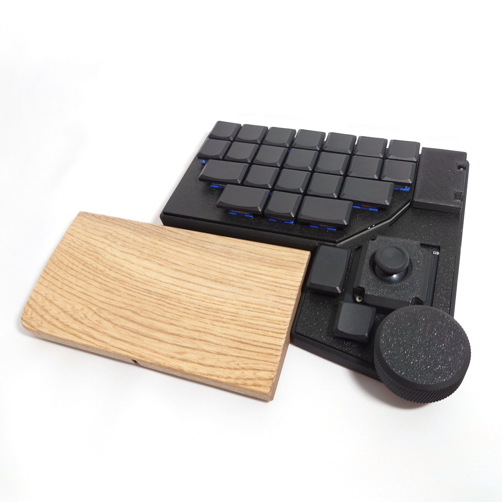
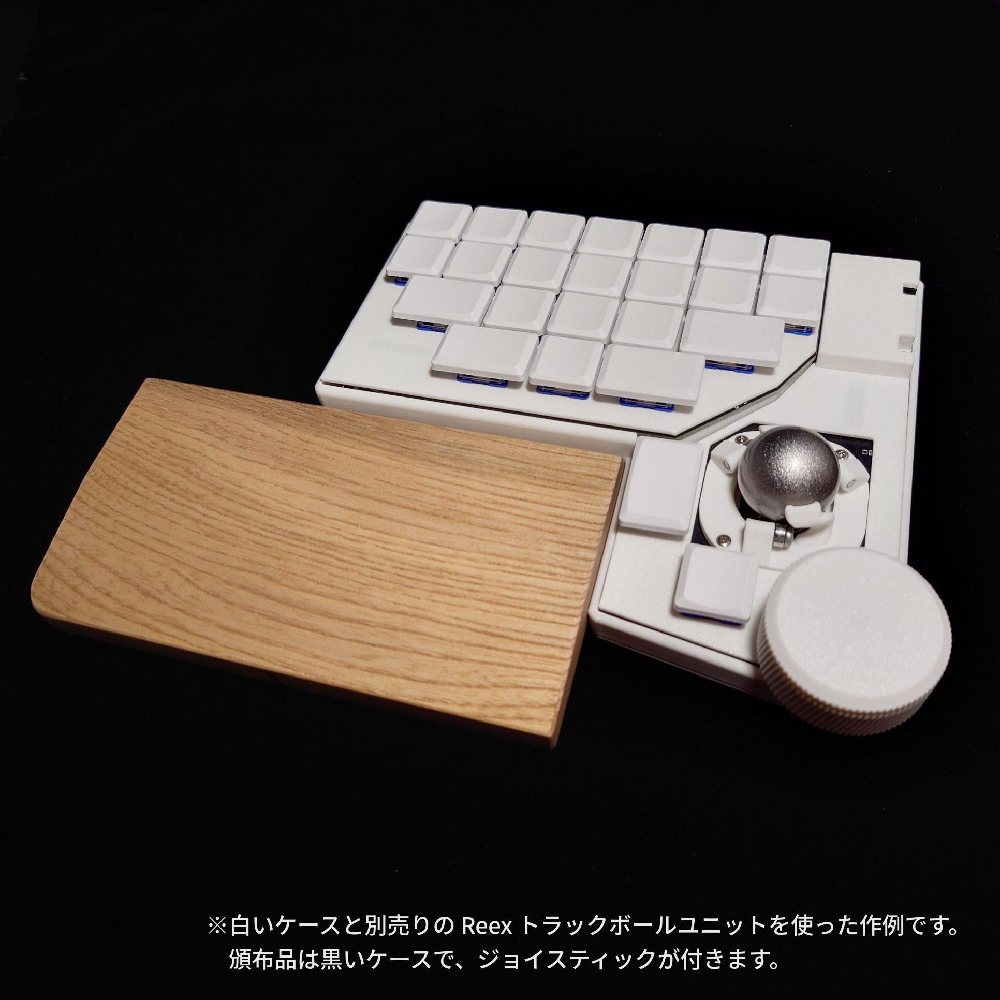

# GBC24
Modular Shortcut Keyboard
  

  
  

右の写真は作例です（白いケースと別売りの Reex トラックボールユニットを使用）。  
頒布品は黒いケースで、ジョイスティックが付きます。

本体の形は、3Dビューアで回したり拡大したりして確認できます。  
[GBC24 3Dビューア](https://kushima8.github.io/gbc24_3d_viewer.html)
 
### 開発協力
 
本製品の開発にあたり、[すこやかむいむい](https://x.com/sukoyakamuimui)さんにご協力いただきました。ありがとうございます。
 
むいむいさんご本人から、紹介イラストもご提供いただきました。
 

  
## GBC24 Build Guide
  
[ビルドガイド（日本語）](Documents/buildguide_pre-soldered.md)  
[接続・設定マニュアル（日本語）](Documents/GBC24_接続・設定マニュアル.md)  
[接続・設定マニュアル（トラックボールユニット装着版・日本語）](Documents/GBC24_接続・設定マニュアル（トラックボールユニット装着版）.md)  
[追加キーコード一覧（日本語）](Documents/addition_keycode.md)  
[ファームウェア書き込み（更新）マニュアル（日本語）](Documents/GBC24_ファームウェア書き込みマニュアル.md)
 

  
 
